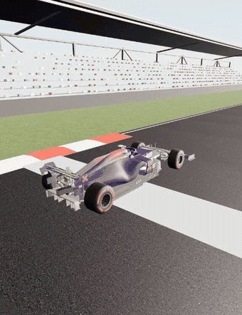

# F1 Racing Game

A browser-based F1 racing game built with React Three Fiber and real Rapier vehicle physics —
a raycast car with suspension, tire slip and yaw damping, driving a hand-traced lap of the
**Buddh International Circuit**, complete with rippled kerbs, grandstands, time-of-day lighting
and gamepad haptics.



▶ [Watch the full-quality clip (mp4)](media/gameplay.mp4)

## Features

- **Real vehicle physics** — Rapier's `DynamicRayCastVehicleController` (4-wheel suspension,
  per-wheel friction/slip, handbrake-induced oversteer), tuned for a stable, controllable feel.
- **A real circuit** — the Buddh International Circuit traced from its official map, with raised,
  rippled kerbs the car physically feels going over them.
- **Grandstands, scenery and 4 camera views** — chase, cockpit, hood and top-down, with
  procedural F1-style grandstands kept clear of the track.
- **Time of day** — Morning / Noon / Afternoon / Sunset / Night lighting via drei `<Sky>` and an
  HDRI environment.
- **Driving assists** — TCS (traction control), a racing-line overlay, and a best-lap ghost car.
- **Gamepad support** — PS5 DualSense / Xbox / any "standard"-mapping controller, with analog
  steering and throttle/brake triggers, plus haptic rumble for kerbs, slides and impacts.
- **A 2D top-down prototype** — the earlier arcade-physics build, kept alongside the 3D game.

## Controls

| Action | Keyboard | Gamepad |
| --- | --- | --- |
| Gas | `W` / `↑` | `R2` |
| Brake | `S` / `↓` / `Space` | `L2` |
| Steer | `A` / `D` | Left stick |
| Handbrake | `Shift` | `✕` / `R1` |
| Camera view | `C` | `▲` |
| Time of day | `T` | — |
| Racing line | `L` | — |
| Ghost car | `G` | — |
| TCS | `K` | — |
| Sound | `M` | — |
| Restart | `R` | `■` |
| Pause | `P` | `Options` |

## Getting started

```bash
npm install
npm run dev
```

Other scripts:

```bash
npm run build   # typecheck + production build
npm test        # run the test suite (vitest)
npm run lint     # oxlint
```

## Tech stack

Vite · React 19 · TypeScript · [React Three Fiber](https://github.com/pmndrs/react-three-fiber) +
[drei](https://github.com/pmndrs/drei) · [Rapier](https://rapier.rs/) via
`@react-three/rapier` · Zustand · Vitest.

## Asset credits

- **Car model:** "Formula 1 Car Midpoly" by LWDream — https://sketchfab.com/3d-models/formula-1-car-midpoly-ca91852b29bb435d8d0278d9131aa775 — licensed CC-BY-4.0. Served from `public/models/f1.glb`.
- **Track asphalt:** "asphalt_track" from Poly Haven (CC0). Downscaled to 1K (diffuse / normal / roughness) in `public/textures/`.
- **Environment lighting:** "Zwartkops Straight Morning" HDRI from Poly Haven (CC0). Downscaled to a 2K Radiance `.hdr` in `public/env/` and used for image-based lighting only (the visible sky is drei `<Sky>`).
- **Engine audio:** supplied by the project owner. Trimmed to a ~38 s loop and re-encoded to mono 128 kbps in `public/audio/engine.mp3`; looped and pitch-/level-modulated at runtime by `useEngineSound`.
